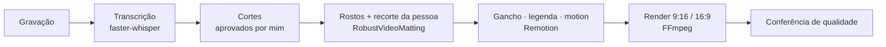

# Editor de vídeo com IA — skill para o Claude Code

> Editor automático de vídeos falados (Reels, TikTok, YouTube) comandado em português, em linguagem natural. Transcreve, corta, legenda, enquadra, cria motion e confere a qualidade sozinho, no padrão visual do **Papo de Fundador**, o perfil de entrevistas com fundadores que eu produzo na JR Consultoria (UFPR).

**👤 Autor:** Ricardo Gasparelo · [Portfólio](https://githubiogithubio.vercel.app) · [LinkedIn](https://www.linkedin.com/in/ricardo-gasparelo-212381380/)

---

## O problema

Cada entrevista do Papo de Fundador rendia horas de edição manual: tirar pausas, legendar palavra a palavra, achar o melhor gancho, enquadrar duas pessoas numa gravação 4K, aplicar a identidade visual e exportar em formatos diferentes. Era o gargalo do perfil.

## O que eu construí

Uma **skill do Claude Code** (um "manual + caixa de ferramentas" que a IA segue) com um pipeline local de vídeo. Eu peço em português ("faz o reels disso", "joga a palavra CAIXA grande atrás de mim quando eu falar", "versão pro YouTube") e o agente traduz o pedido em comandos e edições.

| Etapa | O que a skill faz |
|---|---|
| **Projeto** | copia o original (nunca mexe nele), converte HDR do iPhone para SDR com tone mapping calibrado |
| **Transcrição** | palavra a palavra em pt-BR (faster-whisper), com termos e nomes próprios corrigidos |
| **Cortes** | detecta pausas, falsos começos e repetições; **mostra a lista antes de aplicar** |
| **Gancho** | sugere as frases mais fortes do vídeo para abrir, em P&B com transição para o conteúdo |
| **Câmera virtual** | detecta rostos e enquadra quem fala numa gravação 4K com duas pessoas; zoom fluido, sem "pulos" |
| **Legenda dinâmica** | 2–3 palavras por tela, palavra falada em destaque, fiel ao áudio e sincronizada |
| **Motion** | checklist, esquema, dado animado, citação, lower third, abertura e encerramento da marca e **palavras 3D atrás da pessoa** (recorte da pessoa com IA) |
| **Áudio** | efeitos sonoros no estilo das referências, trilha com ducking, normalização de volume |
| **Exportação** | 9:16 e 16:9 a partir do mesmo projeto, com .srt |
| **Conferência** | relatório de sincronia legenda × fala, volume (LUFS), quadros congelados, imagem × som e folha de quadros para revisão |

## Princípios que eu coloquei na skill

1. **Nunca tocar no original.** Tudo nasce de uma cópia dentro do projeto.
2. **Mostrar antes de gastar.** Lista de cortes e prévia curta antes de cada render final.
3. **Vídeos longos em partes.** Transcrição, máscara e render em blocos, para rodar num Mac de 8 GB.
4. **Identidade visual automática.** Cores, fontes, logo e regras da marca vêm de um único arquivo (`idv.json`).
5. **Conferir antes de entregar.** Nenhum vídeo sai sem o relatório de qualidade.

## Como funciona por dentro

## Tecnologias

`Claude Code (skills)` `Python` `FFmpeg` `faster-whisper` `RobustVideoMatting` `detecção de rosto` `Remotion (React)` `TypeScript` `libass` `Shell`

**Tamanho:** ~24 scripts Python, composições Remotion próprias (incluindo texto 3D com profundidade), instalador multiplataforma (macOS e Linux).

## Resultado

Usada para editar as entrevistas do Papo de Fundador (versões completas e cortes), com legenda fiel, gancho, motion e conferência automática. O que levava horas por vídeo virou uma conversa com aprovações em pontos certos.

## Skills irmãs

- [skill-video-pessoa](https://github.com/ricardogasparelo/skill-video-pessoa): uma pessoa falando para a câmera, do roteiro à edição
- [skill-video-ia](https://github.com/ricardogasparelo/skill-video-ia): vídeos 100% animados a partir da narração
- [resolve-agent](https://github.com/ricardogasparelo/resolve-agent): agente que edita dentro do DaVinci Resolve

---

### Sobre o código

Este repositório é a **vitrine** da skill. O código-fonte completo é privado. Para uma demonstração ou acesso ao código, fale comigo no [LinkedIn](https://www.linkedin.com/in/ricardo-gasparelo-212381380/).

© 2026 Ricardo Friedrich Gasparelo. Todos os direitos reservados. Veja [LICENSE](LICENSE).
